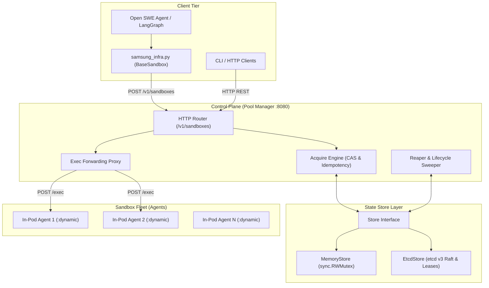
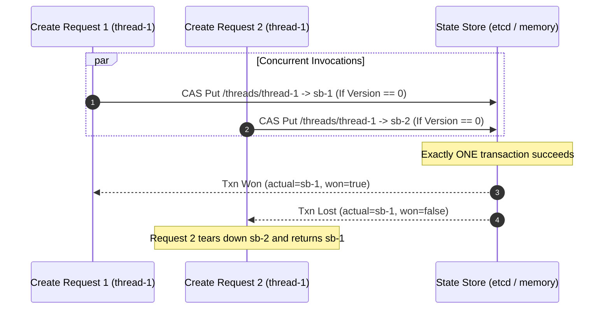
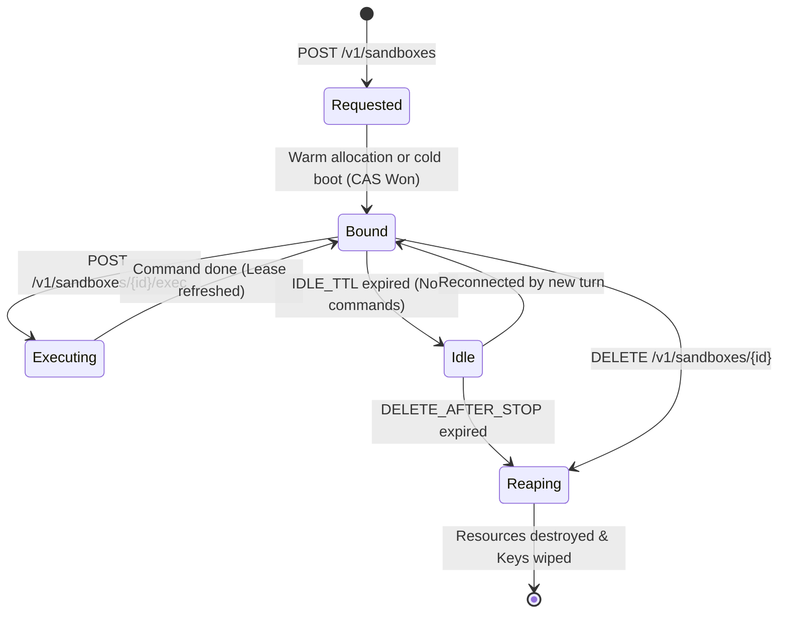

# Design Document: Current Implementation of Self-Hosted Agentic Sandbox Orchestration

**Status:** Implemented (Milestone 1 + Production etcd v3 Layer)  
**System Version:** v0.2.0  
**Target Environment:** Local macOS / Linux (Development & Testing) -> Kubernetes + Kata Containers (Production)  
**Repository:** [github.com/hitesh-982/sandbox-protocol](https://github.com/hitesh-982/sandbox-protocol)  

---

## 1. Overview & Motivation

External agentic sandbox providers (e.g., Runloop, Daytona, Modal, LangSmith) run execution sandboxes outside enterprise network boundaries. This violates strict enterprise data residency rules. 

This project provides an entirely self-hosted sandbox orchestration platform implementing Open SWE's `SandboxBackendProtocol`. 

### Current Status
We have completed the foundational architecture:
1. **Pool Manager Control Plane** (`pkg/poolmanager/`, `cmd/pool-manager/`): A stateless HTTP service managing sandbox lifecycle, acquisition, and proxying.
2. **Pluggable Distributed State Store** (`pkg/store/`):
   - **MemoryStore**: High-speed atomic compare-and-swap (CAS) and lease map for local standalone execution.
   - **EtcdStore**: Production etcd v3 backend with real atomic multi-key transactions (`clientv3.Txn`) and Raft leases.
3. **In-Pod Execution Daemon** (`pkg/agent/`, `cmd/sandbox-agent/`): Lightweight sub-second command executor with timeout and stdout/stderr capture.
4. **Open SWE Adapter** (`agent/integrations/samsung_infra.py`): Python client implementing `BaseSandbox`, registered in `SANDBOX_FACTORIES`.
5. **Local Provisioner** (`pkg/poolmanager/provisioner.go`): Manages local warm sandbox instances for development without requiring a Kubernetes cluster.

---

## 2. System Architecture



---

## 3. Component Specifications

### 3.1 Pool Manager (`pkg/poolmanager`)

The Pool Manager is a stateless HTTP service that coordinates sandbox access.

#### API Endpoints
| Endpoint | Method | Payload / Params | Response | Description |
| :--- | :---: | :--- | :--- | :--- |
| `/v1/sandboxes` | `POST` | `{"thread_id": "...", "image": "..."}` | `{"sandbox_id": "...", "host_id": "...", "path": "..."}` | Idempotent acquire. Paths: `reconnect`, `warm`, `cold`. |
| `/v1/sandboxes/{id}` | `GET` | None | `{"sandbox_id": "...", "state": "...", "last_active": "..."}` | Serialized session metadata. |
| `/v1/sandboxes/{id}/exec` | `POST` | `{"command": "...", "timeout": 30}` | `{"stdout": "...", "stderr": "...", "exit_code": 0}` | Executes command and refreshes idle lease. |
| `/v1/sandboxes/{id}` | `DELETE`| None | `204 No Content` | Destroys sandbox and unbinds thread. |
| `/healthz` | `GET` | None | `200 OK` | Liveness healthcheck. |

---

### 3.2 State Store & Data Model (`pkg/store`)

The state store handles distributed synchronization and TTL leases.

```
/threads/{thread_id}        -->  sandbox_id     (Written with atomic CAS)
/sandboxes/{sandbox_id}     -->  JSON metadata  (State, HostID, AgentAddr, LastActive)
/leases/idle/{sandbox_id}   -->  empty          (Attached to TTL lease)
```

#### Atomic CAS Thread Binding Logic


---

### 3.3 In-Pod Execution Agent (`pkg/agent`)

A standalone Go HTTP service running inside each sandbox:
- **Port:** Configurable or dynamically assigned.
- **`POST /exec`:**
  - Decodes `{"command": string, "timeout": int, "work_dir": string}`.
  - Spawns `exec.CommandContext(ctx, "sh", "-c", command)`.
  - Captures stdout and stderr into separate in-memory buffers.
  - Enforces process timeouts: kills hung processes and returns exit code `124`.
- **`GET /healthz`:** Returns 200 OK when ready to accept commands.

---

### 3.4 Open SWE Adapter (`agent/integrations/samsung_infra.py`)

A pure-Python adapter matching Open SWE's `SandboxBackendProtocol`:
- Extends `BaseSandbox` and implements `execute(command, timeout)`.
- **Derived File Operations:**
  - `read(path)` $\rightarrow$ runs `cat <path>`.
  - `write(path, content)` $\rightarrow$ encodes content in Base64 and pipes to `printf '%s' <b64> | base64 -d > <path>`.
  - `edit(path, old, new)` $\rightarrow$ reads content, validates presence of `old`, substitutes `new`, and rewrites.
  - `ls(path)` $\rightarrow$ runs `ls -1 <path>`.
  - `grep(pattern, path)` $\rightarrow$ runs `grep -rn <pattern> <path>`.
  - `glob(pattern, path)` $\rightarrow$ executes Python glob lookup or fallback `find`.
- Automatically registered in `SANDBOX_FACTORIES["samsung"]`.

---

## 4. Lifecycle & The Reaper Engine

Sandboxes transition through states enforced by the autonomous background reaper loop:



- **`IDLE_TTL` (default 10m):** Duration of inactivity before a bound sandbox is marked `Idle`.
- **`DELETE_AFTER_STOP` (default 60m):** Maximum time an idle sandbox can persist before the reaper destroys it.
- **`ReaperInterval` (default 10s-30s):** Periodic reconciliation tick.

---

## 5. Verification & Testing Strategy

The repository includes test suites that run without cloud resources or virtual machines:

| Test File | Target Tested | Highlights |
| :--- | :--- | :--- |
| [`pkg/store/store_test.go`](file:///Users/hitesh/Downloads/sandbox/pkg/store/store_test.go) | MemoryStore | 20-goroutine CAS race test, TTL lease expiration, CRUD. |
| [`pkg/store/etcd_test.go`](file:///Users/hitesh/Downloads/sandbox/pkg/store/etcd_test.go) | EtcdStore | In-process embedded etcd v3 Raft server, real distributed CAS transactions, lessor lease sweeps. |
| [`pkg/agent/agent_test.go`](file:///Users/hitesh/Downloads/sandbox/pkg/agent/agent_test.go) | In-Pod Agent | Command stdout/stderr capture, non-zero exit codes, process timeout termination. |
| [`pkg/poolmanager/poolmanager_test.go`](file:///Users/hitesh/Downloads/sandbox/pkg/poolmanager/poolmanager_test.go) | Pool Manager | REST API integration, warm vs. cold boot, idempotent reconnect, reaper idle transitions. |
| [`tests/test_samsung_infra.py`](file:///Users/hitesh/Downloads/sandbox/tests/test_samsung_infra.py) | Python Adapter | End-to-end Open SWE protocol verification, derived file operations (`read`, `write`, `edit`, `ls`, `grep`). |

---

## 6. Comparison: Current Local vs. Production K8s

| Feature | Current Local Implementation | Target Production (Kubernetes + Kata) |
| :--- | :--- | :--- |
| **Isolation Barrier** | Process-level (`sh -c` on host) | **VM-level (Kata Containers microVM per pod)** |
| **State Backend** | In-Memory or Local etcd | **Multi-node High Availability etcd cluster** |
| **Provisioning** | `LocalProvisioner` (In-process agents) | **`SandboxPool` K8s CRD & Operator** |
| **Warm Pool Management** | In-memory slice of warm agents | **K8s Custom Controller reconciling pod counts** |
| **Egress Security** | Host networking | **Default-deny NetworkPolicy + Allowlist Forward Proxy** |
| **Telemetry / Audit** | Application logs | **Falco eBPF syscall monitor + Append-only Audit WAL** |

---

## 7. File Map of Implemented Repository

```
sandbox-protocol/
├── cmd/
│   ├── pool-manager/main.go       # Pool Manager CLI (Memory or etcd mode)
│   └── sandbox-agent/main.go      # In-pod execution daemon CLI
├── pkg/
│   ├── api/types.go               # API request/response structs and states
│   ├── store/
│   │   ├── store.go               # Store interface & MemoryStore
│   │   ├── store_test.go          # MemoryStore tests
│   │   ├── etcd.go                # Production etcd v3 client & CAS Txns
│   │   └── etcd_test.go           # Embedded etcd v3 integration tests
│   ├── agent/
│   │   ├── agent.go               # Command execution engine
│   │   └── agent_test.go          # Agent tests
│   └── poolmanager/
│       ├── poolmanager.go         # REST API & Reaper engine
│       ├── provisioner.go         # LocalProvisioner
│       └── poolmanager_test.go    # Pool Manager integration tests
├── agent/
│   └── integrations/
│       └── samsung_infra.py       # Open SWE BaseSandbox adapter
├── tests/
│   └── test_samsung_infra.py      # Python integration test suite
├── docs/
│   ├── ARCHITECTURE_AND_EVALUATION.md
│   └── DESIGN_DOC_CURRENT_IMPLEMENTATION.md
├── Makefile                       # Unified build and test targets
└── README.md                      # Usage guide
```
